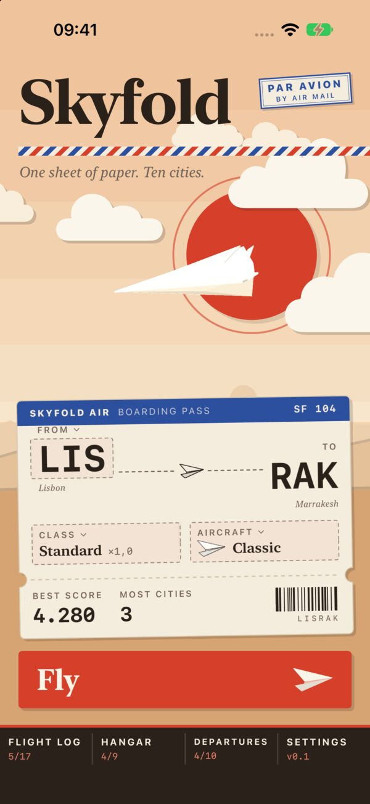
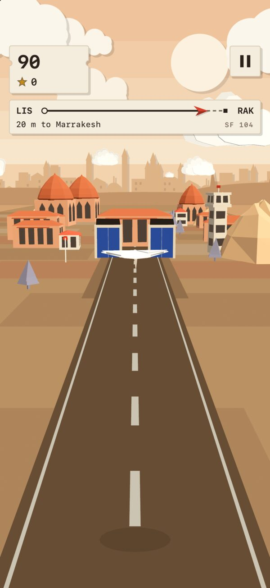
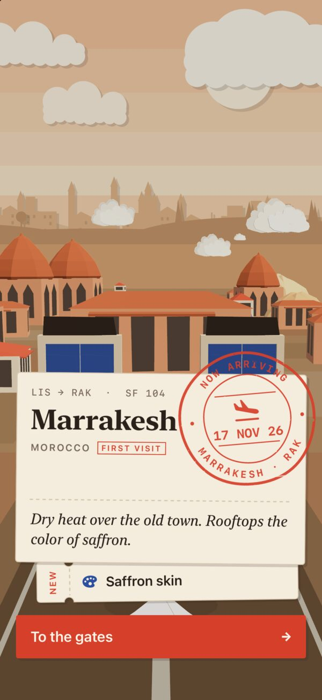
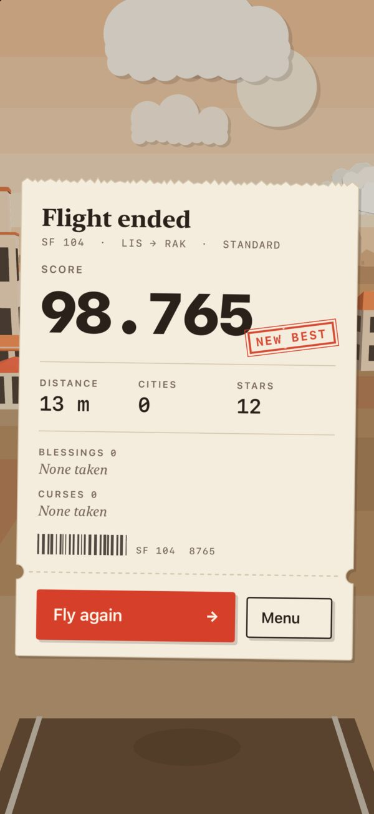
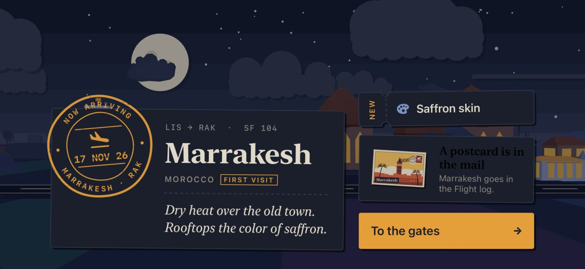
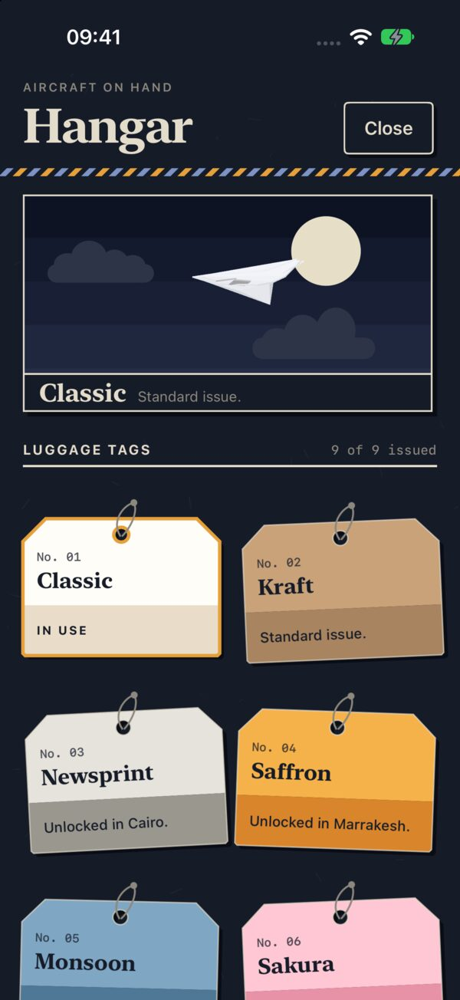
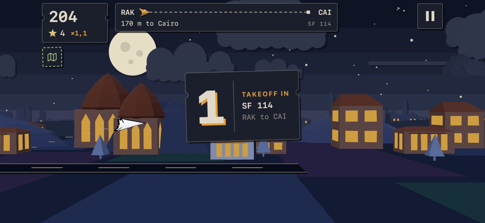

# Skyfold

You are a paper airplane. Fly from city to city around the world, dodge what the sky throws at
you, and at every airport pick one of two mystery gates: one blesses the rest of your run, the
other curses it.

An iPhone game in SwiftUI and RealityKit, for portrait and landscape.

  
  
  
  

  

## How it plays

- **Three altitude lanes.** Swipe up or down, or tap the top or bottom of the screen, to climb or
  dive. Stars mark the safe line through the traffic.
- **Ten cities.** Each leg ends with a landing in the next one: Lisbon, Marrakesh, Cairo, Istanbul,
  Mumbai, Kyoto, Sydney, Honolulu, Rio de Janeiro and New York.
- **Two gates at every airport.** One hides a blessing, such as Tailwind, Paper Shield or
  Shortcut. The other hides a curse, such as Headwind, Fog Bank or Soggy Paper. Whatever you pick
  stays with you until the run ends. There are 8 blessings and 9 curses to log.
- **Things to unlock.** First landings open plane skins, harder difficulties (Breezy to Paper Cut)
  and new departure airports. The flight log keeps your records and every gate you have opened.
- **Day and night.** Flights run through dusk into night, follow your clock, or stay on one.
- **Two views.** Portrait flies behind the plane; landscape watches it from the side.

## The look

Skyfold is drawn as airmail and travel paper: cream card stock, red and blue airmail stripes,
boarding passes, passport stamps and a split-flap departures board. The 3D world is a pop-up book
of folded and cut paper. [ART_DIRECTION.md](ART_DIRECTION.md) has the details.

  
  

## How it is made

- **3D world, 2D rules.** The game is plain 2D math: distance flown and altitude lane. RealityKit
  only draws that state with low-poly paper models, and SwiftUI draws every screen.
- **No audio files.** The music and sound effects are synthesized in code when the game starts.
- **Models from scripts.** Each 3D model is a Blender Python script in `Tools/Blender`, so the
  whole set can be tweaked and rebuilt in seconds.

## Run it

You need Xcode 27 or later; the game runs on iOS 18 or later.

1. Clone this repository and open `Skyfold.xcodeproj`.
2. Pick an iPhone simulator and press Run.
3. To play on your own iPhone, choose your team under *Signing & Capabilities* and change the
   bundle identifier if needed.

## Status

Skyfold is in development. The `experimental` branch has features on trial, each with its own
switch in Settings: postcards from every city, a near-miss bonus, wind gusts, a ghost of your best
run and a daily route.

## Working on Skyfold

[DEVELOPING.md](DEVELOPING.md) covers the project layout, building and testing on Linux with the
Mac only for Xcode, the debug launch arguments, and how to rebuild the models.
